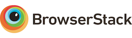

# Bootstrap Switzerland

This project is a fork of  [italia/bootstrap-italia](https://github.com/italia/bootstrap-italia), customized to align with the Design System of the Swiss Confederation 🇨🇭.

For details about the Swiss Design System, see:

- [Design System for the Swiss Confederation (GitHub)](https://github.com/swiss/designsystem)
- [Design System for the Swiss Confederation (Stoybook)](https://swiss.github.io/designsystem/?path=/docs/get-started--docs)
- [Design System Core Library (Figma)](https://www.figma.com/design/3UYgqxmcJbG0hpWuti3y8U/🇨🇭Design-System-Core-Library)

For a preview and documentation of the theme, visit: https://swiss.github.io/bootstrap-switzerland/

## Branches

| Branch     | Purpose                                                                                                                           |
| ---------- | --------------------------------------------------------------------------------------------------------------------------------- |
| `cd-bund`  | Default branch. The Swiss theme: upstream bootstrap-italia plus the adaptations for the Swiss Design System. All work happens here. |
| `main`     | Unmodified mirror of upstream [`italia/bootstrap-italia`](https://github.com/italia/bootstrap-italia) `main`. Never commit to it.  |
| `gh-pages` | Built documentation and pre-built theme, generated by the deployment. Never commit to it.                                         |

## Deployment

The preview and documentation are deployed to the `gh-pages` branch automatically by the
[Update documentation](.github/workflows/update_docs.yml) GitHub Action on every push to `cd-bund`.
It can also be triggered manually from the Actions tab.

The deployment includes a pre-built version of the theme that can be used as an NPM dependency in your project:
`swiss/bootstrap-switzerland#gh-pages`

To deploy manually from your machine instead, you need Ruby 3.3 (with Bundler) and Node 22,
or use the provided Docker image. Always build the theme first, as `dist/` is part of the deployed site:

```bash
bundle install
npm ci
npm run build
npm run documentation-deploy-to-gh-pages
```

## Syncing with upstream (bootstrap-italia)

This theme follows upstream bootstrap-italia releases. Upstream changes are **merged** into `cd-bund`
(not rebased), so the history of `cd-bund` is never rewritten and conflicts that were resolved once
do not come back.

### 1. Notification

The [Check upstream](.github/workflows/check-upstream.yml) GitHub Action runs every Monday (and can be
started manually from the Actions tab). If `italia/bootstrap-italia` has commits that are not yet in
`cd-bund`, it opens an issue labelled `upstream-sync` with the list of commits and a link to the
changes. The issue is updated on every run and closed automatically once `cd-bund` is up to date.

The merge itself is not done by GitHub Actions: the built-in `GITHUB_TOKEN` is not allowed to push
commits that change files in `.github/workflows/`, which upstream changes regularly. Doing it with a
token that is allowed (a personal access token or a GitHub App) would tie the sync to a personal
account or require an organization-owned app. The merge is therefore done locally with your own
credentials.

### 2. Merge

Prerequisites: Git and Node.js/npm, a clean working tree and an up-to-date `cd-bund`.

```bash
git switch cd-bund
git pull
./scripts/sync-upstream.sh
```

The [script](scripts/sync-upstream.sh):

1. adds the `upstream` remote (`https://github.com/italia/bootstrap-italia.git`) if it is missing and fetches `upstream/main`,
2. creates a branch `sync/upstream-<date>-<commit>` from `cd-bund` and merges `upstream/main` into it,
3. resolves the recurring conflicts automatically:
   - **Fork-owned files** (`publiccode.yml`, `CODEOWNERS`, the workflows the fork changed or removed, ...)
     always keep the `cd-bund` version (files deleted on `cd-bund` stay deleted). The list is `KEEP_OURS`
     at the top of the script. If upstream changed one of these files, the script prints a `git diff`
     command so you can check whether something should be ported by hand.
   - **`package.json`** is merged field by field: upstream wins for fields the fork did not change, the
     fork wins for fields it changed (name, description, repository, ...). `version` always follows
     upstream. Fields changed on both sides are listed for review.
   - **`package-lock.json`** is taken from upstream, with the package name and version set to ours.
     If the fork's dependencies ever differ from upstream, the lockfile is updated with
     `npm install --package-lock-only`.
4. commits the merge if nothing else conflicts. Nothing is pushed.

If other files conflict (typically SCSS, templates or docs the fork adapted), the script stops and
lists them. Resolve them, then:

```bash
git add <files>
git commit --no-edit
```

To abandon a sync instead: `git merge --abort && git switch cd-bund && git branch -D sync/upstream-...`
(the script prints the exact command).

### 3. Check

Build the theme and check the documentation locally, especially the components upstream changed:

```bash
npm ci
npm run build
npm run documentation-serve
```

This needs Ruby 3.3 with Bundler. Alternatively use the Docker setup: `docker compose up`.

### 4. Publish

```bash
git switch cd-bund
git merge --ff-only sync/upstream-<date>-<commit>
git push origin cd-bund
git branch -d sync/upstream-<date>-<commit>
```

The push deploys the documentation (see [Deployment](#deployment)) and the `upstream-sync` issue is
closed on the next run of the Check upstream workflow. If you prefer a review by someone else, push the
sync branch and open a pull request into `cd-bund` instead.

Optionally update the `main` mirror as well:

```bash
git push origin upstream/main:main
```

### Adding fork-specific files

If you change a file in a way that should always win over upstream (for example another workflow),
add it to `KEEP_OURS` in [`scripts/sync-upstream.sh`](scripts/sync-upstream.sh). Everything else is
merged normally, so keep the fork's changes to upstream files as small as possible to reduce conflicts.

Below is the original README for the Italian version.

---

[](https://www.npmjs.com/package/bootstrap-italia)
[](https://github.com/italia/bootstrap-italia/actions)
[](https://github.com/italia/bootstrap-italia/issues)
[](https://github.com/italia/bootstrap-italia/blob/main/LICENSE)
[](https://developersitalia.slack.com/messages/C7VPAUVB3/)
[](https://slack.developers.italia.it/)

_🇬🇧 [English version](README.EN.md)_

_⚠️ [La versione 1.x di Bootstrap Italia (basata su Bootstrap 4) è deprecata](https://github.com/italia/bootstrap-italia/tree/1.x)_

Bootstrap Italia è un framework basato su [Bootstrap 5](https://getbootstrap.com/docs/5.2/getting-started/introduction/).

Bootstrap Italia eredita tutte le funzionalità, componenti, mixins, grid system, e altro già presenti in Bootstrap 5, personalizzandole per implementare soluzioni secondo le [Linee guida di design per i siti internet e i servizi digitali delle Pubbliche Amministrazioni](https://designers.italia.it/norme-e-riferimenti/).

Bootstrap Italia è la risorsa di sviluppo dell'ecosistema [design system del Paese](https://designers.italia.it/design-system/come-iniziare/) e implementa pattern e componenti di [UI Kit Italia](https://github.com/italia/design-ui-kit/) in codice pronto all'uso! 

La roadmap del progetto è consultabile nel [piano attività di Designers Italia](https://designers.italia.it/piano-attivita/).

**[Esplora la documentazione di sviluppo »](https://italia.github.io/bootstrap-italia/)**

**[Esplora la documentazione del design system del Paese »](https://designers.italia.it/design-system/come-iniziare/)**

oppure

**[Scarica l'ultima versione del framework »](https://github.com/italia/bootstrap-italia/releases)**

## Indice

- [Segnalazione bug e richieste](#segnalazione-bug-e-richieste-di-aiuto)
- [Come contribuire](#come-contribuire)
- [Licenze software dei componenti di terze parti](#licenze-software-dei-componenti-di-terze-parti)

## Segnalazioni e richieste di aiuto

Vuoi fare una segnalazione o una richiesta?

Prima di tutto assicurati che sia un team relativo a Bootstrap Italia e non alla libreria Bootstrap da cui deriva (in tal caso puoi fare riferimento al [repository di Bootstrap](https://github.com/twbs/bootstrap)), scopri il [modello di contribuzione del design system del Paese](https://designers.italia.it/design-system/come-contribuire/), e poi dai un'occhiata alle indicazioni di dettaglio su [come creare una issue a Bootstrap italia](https://github.com/italia/bootstrap-italia/blob/main/CONTRIBUTING.md#creare-una-issue).

## Come contribuire

Vorresti dare una mano su Bootstrap Italia? **Sei nel posto giusto!**

Se non l'hai già fatto, inizia spendendo qualche minuto per approfondire la tua conoscenza sulle "Linee guida di design per i siti internet e i servizi digitali della PA" e del manuale operativo di design a supporto partendo dalla [pagina dedicata di Designers Italia](https://designers.italia.it/norme-e-riferimenti), scopri il [modello di contribuzione del design system del Paese](https://designers.italia.it/design-system/come-contribuire/), e fai riferimento alle [indicazioni di dettaglio su come contribuire a Bootstrap Italia](https://github.com/italia/bootstrap-italia/blob/main/CONTRIBUTING.md).

A questo punto, è necessario impostare il tuo ambiente locale per la compilazione dei file sorgente e la generazione
della documentazione. Puoi usare [Docker](https://docs.docker.com/get-started/) per far partire l'ambiente di sviluppo.

```sh
docker-compose up
```

## Licenze software dei componenti di terze parti

### Componenti distribuiti con Bootstrap Italia

Vengono di seguito elencati i componenti distribuiti con Bootstrap Italia che hanno una propria licenza diversa da CC0.

- [Bootstrap 5](https://getbootstrap.com) © The Bootstrap Authors, licenza MIT
- [Popper.js](https://popper.js.org) © Floating UI contributors, licenza MIT
- [SplideJS](https://splidejs.com) © Naotoshi Fujita, licenza MIT
- [Accessible Autocomplete](https://alphagov.github.io/accessible-autocomplete) © Crown Copyright (Government Digital Service), licenza MIT
- [AnimeJS](https://animejs.com) © Julian Garnier, licenza MIT
- [Just Validate](https://just-validate.dev) © Horprogs, licenza MIT
- [Mini Masonry](https://github.com/Spope/MiniMasonry.js) © Spope, licenza MIT
- [Progressbar.js](https://kimmobrunfeldt.github.io/progressbar.js) © Kimmo Brunfeldt, licenza MIT

### Principali dipendenze per la fase di compilazione e sviluppo

- Generatore di siti statici per ruby [Jekyll](https://jekyllrb.com), © Tom Preston-Werner and Jekyll contributors, licenza MIT
- Tool per il testing della correttezza formale dell'HTML [html-proofer](https://github.com/gjtorikian/html-proofer), © Garen Torikian, licenza MIT
- Tool per il reload automatico del browser [Browser Sync](https://www.browsersync.io/) Apache License Version 2.0
- Gestione del versionamento [conventional-changelog](https://github.com/conventional-changelog/conventional-changelog/) © conventional-changelog team, ISC License
- Build system per le librerie Javascript e CSS [Rollup.js](https://rollupjs.org/), © [questi contributori](https://github.com/rollup/rollup/graphs/contributors), licenza MIT
- Code formatter per Javascript [Prettier](https://prettier.io/), © James Long and contributors, licenza MIT
- Compilazione SASS [sass](https://github.com/sass/dart-sass), © Google Inc., licenza MIT
- GitHub REST API client per JavaScript [Octokit rest.js](https://octokit.github.io/rest.js/) © Cloud9 IDE, Inc. (Mike de Boer), 2017-2018 Octokit contributors, licenza MIT

### Componenti utilizzati per la documentazione

Di seguito sono elencati invece i componenti utilizzati per il sito della documentazione ma non ridistribuiti nella libreria Bootstrap Italia

- [tsParticles](https://particles.js.org/) © Matteo Bruni, licenza MIT
- [clipboard.js](https://clipboardjs.com/) © Zeno Rocha, licenza MIT
- [AnchorJS](https://www.bryanbraun.com/anchorjs/) © Bryan Braun, licenza MIT
- [Algolia DocSearch](https://docsearch.algolia.com/) © Algolia, licenza MIT

## Licenza

La licenza di Bootstrap Italia è **BSD 3-Clause** ed è visibile nel file [LICENSE](https://github.com/italia/bootstrap-italia/blob/main/LICENSE).

<a href="https://www.browserstack.com/" target="_blank"></a>

We are using BrowserStack for interactive cross browser testing. They are sponsoring our open source project!
